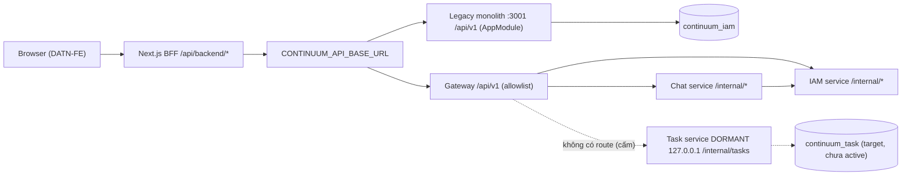
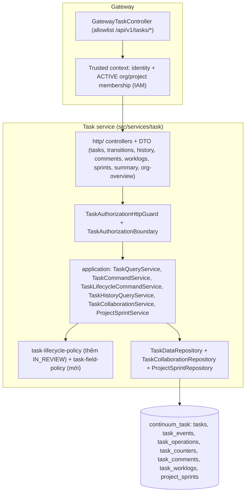

# 05 — Backend Architecture (hiện trạng và đề xuất cho Workspace Task)

## 1. Kiến trúc hiện tại (đã kiểm chứng)

Kết luận: BE là **modular monolith NestJS 11** (DEC-013). Song song có một chế độ microservices qua Gateway, và Task là service **dormant**.

| Thành phần | Vai trò | Evidence |
|---|---|---|
| `src/main.ts` + `src/app.module.ts` | Monolith mặc định (`npm start`), import IAM, Capture, Jira, Lifecycle, Chat, Handover, Ingestion, Notification, AiEngine. **Không** import Task | `src/app.module.ts:14-29` |
| `src/bootstrap.ts` | prefix `api/v1`, helmet, CORS (cho phép `If-Match`, `Idempotency-Key`; expose `ETag`), `ValidationPipe` (whitelist + forbidNonWhitelisted), `StructuredExceptionFilter` | `src/bootstrap.ts:~16-44` |
| `src/gateway/**` | Proxy theo allowlist; rewrite `/api/v1/` → `/internal/`; map timeout → 504, unavailable → 503 | `gateway-iam.controller.ts:914-976`; `gateway.module.ts:18-22` |
| `src/services/<domain>/` | Tầng `controllers/` → `application/` → `infrastructure/mongodb` | cây thư mục `src/services/*` |
| Task service | `main.ts` (loopback), `runtime/**` (policy, lifecycle, history), `http/**` (controller dormant), `infrastructure/mongodb/**` (`TaskDataRepository`) | `src/services/task/**` |
| Authorization | `ProjectAccessAuthorizationGuard` + `AuthorizationPolicy.evaluateProjectAccess` đọc evidence từ Mongo | `project-access-authorization.guard.ts:35-101`; `authorization.policy.ts:304-389` |
| Persistence | Mongoose 8 / MongoDB 7. Database-per-service (ADR-003/DEC-011), `continuum_audit` dùng chung cho audit | `AGENTS.md:19`; `src/common/mongodb/database-names.ts` |
| Cache | Redis chỉ cho Chat, key theo org/actor/generation | `chat-cache.repository.ts:67-134` |
| Queue | Đã khai báo BullMQ names nhưng worker chưa có handler | `*/infrastructure/queues/queue.names.ts`; `src/workers/main.ts` |

**Kiểu kiến trúc:** modular monolith với tầng controller/application/infrastructure tách rõ ràng. Các phần sau được dùng **có chọn lọc**, không áp dụng toàn bộ:
- Repository pattern
- CQRS-lite (Task tách command `TaskLifecycleCommandService` và query `TaskHistoryQueryService`)
- Outbox (email IAM)

Không có event bus chạy thật giữa các module.

## 2. Đề xuất kiến trúc cho Workspace Task (đã đồng bộ G1, G4, G6, G7, G8, G10)

**Quyết định:** đặt toàn bộ logic Task, Comment, Worklog và Project Sprint trong **Task service sẵn có** (`src/services/task/**`, database `continuum_task`, runtime owner: **Thắng**). Không tạo module "work" mới, không thêm collection song song trong IAM.

Lý do:
- ADR-010 đã chốt ranh giới Task.
- ADR-009 chốt Task là nguồn duy nhất.
- Đã có schema, index, repository, policy và history được approve ở mức dormant.
- Tạo module khác sẽ nhân bản source of truth, vi phạm nguyên tắc "không tạo database task thứ hai".

### 2.1 Trách nhiệm từng tầng

| Tầng | Làm | Không làm |
|---|---|---|
| Gateway controller | allowlist path; kiểm tra session; forward trusted context theo DR-3; map 503/504 | business rule, query DB Task |
| Task `http/` | validate DTO (class-validator, whitelist), parse `If-Match`/`Idempotency-Key`, map kết quả sang HTTP | logic nghiệp vụ |
| `TaskAuthorizationBoundary` | lấy evidence ACTIVE org + project membership + role (DR-8); quyết định ALLOW/DENY theo op | tin bất kỳ id hay role nào từ FE |
| Application services | orchestration, CAS, idempotency, transaction (task + event, hoặc complete sprint + dời task) | chi tiết Mongo |
| Policy | hàm thuần: transition (mở rộng `IN_REVIEW`), field-update (ai sửa field nào, `parentId` 1 cấp, `steps` ≤ 50) | I/O |
| Repositories | query có scope `projectId` / `organizationId`, projection, keyset, aggregation, index-aware | quyết định quyền |

**Không thêm** port/adapter interface cho repository vì chỉ có một implementation (Ponytail: "no interfaces with only one implementation").

### 2.2 Thay đổi schema & collection mới (gate G6, G7, G8, G10 — cần migration MỚI)

1. **Mở rộng collection `tasks`** (`task-database-schema.ts:127-141`, `additionalProperties:false`):
   - Enum `status`: mở rộng thành `['TODO', 'IN_PROGRESS', 'IN_REVIEW', 'BLOCKED', 'DONE', 'CANCELLED']` (G7).

| Field mới trên `tasks` | Kiểu | Bắt buộc | Ghi chú |
|---|---|---|---|
| `organizationId` | ObjectId | ✓ (task mới) | **Bất biến**, lấy từ trusted context lúc tạo, không bao giờ nhận từ body. Phục vụ màn hình Manager toàn org và cách ly tenant ở tầng dữ liệu (G10 Phương án A đã chốt; Project gắn vĩnh viễn với Organization lúc tạo) |
| `key` | string | ✓ (task mới) | unique `{projectId, key}` |
| `type` | enum `TASK/BUG/STORY` | ✓, default `TASK` | |
| `priority` | enum `LOW/MEDIUM/HIGH` | ✓, default `MEDIUM` | |
| `description` | string ≤ 20000 \| null | | |
| `dueDate`, `startDate` | Date \| null | | validate `startDate ≤ dueDate` |
| `parentId` | ObjectId \| null | | chỉ 1 cấp, cùng project |
| `sprintId` | ObjectId \| null | | tham chiếu `project_sprints._id` cùng project |
| `labels` | string[] ≤ 20 | default `[]` | mỗi label 1..40 ký tự |
| `steps` | `{id, text, done}[]` ≤ 50 | default `[]` | checklist ngay trên task (G8) |

2. **Các collection mới trong `continuum_task` (G6, G8):**
   - `task_counters`: `{_id: projectId, seq: int}` để cấp phát atomic `key` `<CODE>-<n>`.
   - `task_comments`: `{_id, taskId, projectId, organizationId, authorId, body, createdAt}`, index `{projectId: 1, taskId: 1, _id: 1}`.
   - `task_worklogs`: `{_id, taskId, projectId, organizationId, authorId, minutes, note, loggedAt, createdAt}`, index `{projectId: 1, taskId: 1, _id: -1}`.
   - `project_sprints`: `{_id, projectId, organizationId, name, goal, status: 'PLANNED'|'ACTIVE'|'COMPLETED', startDate, endDate, createdBy, createdAt, completedAt, version}`, index `{projectId: 1, createdAt: -1}` và partial unique index `{projectId: 1}` với `partialFilterExpression: {status: 'ACTIVE'}` (đảm bảo tối đa 1 sprint `ACTIVE` mỗi project).

3. **Migration:**
   - Tạo script mới `scripts/migrations/<date>-task-workspace-fields.mjs` (cấm sửa migration cũ). Theo pattern của `20261019-task-lifecycle-contract.mjs`: dry-run report + `--expected-report-sha256` + `--task-writes-paused`.
   - Task service chưa từng active ở production nên hiện chưa có dữ liệu cũ; nếu có dữ liệu test thì script backfill mặc định hoặc yêu cầu làm sạch trước khi áp validator mới.
   - **Rollback:** khôi phục validator cũ sau khi `$unset` các field mới và drop các index mới.

4. **Event (`task_events`):**
   - Cập nhật enum `fromStatus`/`toStatus` thêm `IN_REVIEW`.
   - Thêm các loại sự kiện `TASK_UPDATED {changedFields, version}`, `TASK_COMMENT_ADDED {commentId}`, `TASK_WORKLOG_ADDED {worklogId, minutes}`, và sự kiện sprint (`SPRINT_CREATED`, `SPRINT_UPDATED`, `SPRINT_COMPLETED`) ghi chung transaction với mutation. Mọi sự kiện đều lưu `{actor, actorType, organizationId, projectId}` để đảm bảo truy vết đầy đủ khi Manager (`ADMIN`) thao tác trên bất kỳ project nào.

### 2.3 Concurrency và consistency

| Vấn đề | Cách xử lý | Lý do |
|---|---|---|
| Hai người sửa cùng task hoặc cùng sprint | `updateOne({_id, projectId, organizationId, version: expected}, {$set…, $inc:{version:1}})`; `matchedCount=0` thì đọc lại để phân biệt 404 và 409 (`TASK_VERSION_CONFLICT` / `SPRINT_VERSION_CONFLICT`); thiếu `If-Match` trả `428 PRECONDITION_REQUIRED` | atomic trên 1 document, chống ghi đè mù giữa 2 Leader/Manager |
| Ghi task/comment/worklog/sprint + event | transaction (đã có trong `create`/`transitionStatus`) | cần nhất quán đa document; CI dùng replica set |
| Complete sprint + dời task chưa xong | Trước và trong transaction: xác thực sprint nguồn `{_id: sprintId, projectId, organizationId, status: 'ACTIVE', version: expected}` và (nếu `moveIncompleteToSprintId != null`) xác thực sprint đích `{_id: moveIncompleteToSprintId, projectId, organizationId, status: 'PLANNED'}`. Sau đó cập nhật sprint nguồn sang `COMPLETED` (`version + 1`) và chạy `updateMany({organizationId, projectId, sprintId, status: {$nin: ['DONE', 'CANCELLED']}}, {$set: {sprintId: moveIncompleteToSprintId, updatedAt: now}, $inc: {version: 1}})` kèm ghi event `SPRINT_COMPLETED` | chống gán chéo project/org và chống race condition khi đóng sprint |
| Tối đa 1 ACTIVE sprint/project | partial unique index `{projectId: 1}` với `{status: 'ACTIVE'}` | chống race condition khi 2 Leader bấm Start Sprint cùng lúc |
| Retry create / comment / worklog / sprint | `Idempotency-Key` lưu trong `task_operations` (TTL 24h, unique `{actorId, projectId, operationId}`) | tái dùng collection có sẵn, không thêm Redis |
| Cấp key song song | `findOneAndUpdate($inc)` + unique index | atomic, không race |
| Distributed lock | **Không dùng** | không có yêu cầu |

### 2.4 Bảo mật

- Object-level authorization ở **mọi** op: query luôn có `projectId` lấy từ path **và** đã được xác thực membership (hoặc role ADMIN toàn org). Lấy task/comment/worklog/sprint theo `{_id, projectId}` (chống IDOR chéo project).
- `assigneeId` mới phải là ACTIVE project member. Nguồn evidence lấy theo DR-8.
- `assigneeId=me` được resolve ở server.
- **Manager (`ADMIN`):** hai route `/api/v1/tasks/organization/*` chỉ ADMIN truy cập; role khác nhận 404. Org lấy từ session, và mọi truy vấn của Manager đều ràng buộc `organizationId` từ trusted context. Với route theo project, ADMIN được xem, tạo và sửa task ở mọi project trong org (kể cả PRIVATE).
- Mọi thay đổi do ADMIN thực hiện ghi `actor`/`actorType` vào `task_events` để truy vết.
- Không có trường nào nhận `organizationId` hay `role` từ client.
- `q` được escape regex và giới hạn độ dài 2–100 kèm `maxTimeMS` để chống ReDoS và full scan.
- CSRF double-submit cho mọi mutation.

**Phát hiện ngoài phạm vi (cần task riêng):** các mutation Project trong `project-access.controller.ts:159-372` **không** kiểm tra CSRF, khác với các controller command của IAM. Mức độ **Medium**. Ghi nhận ở [09](09-final-audit.md).

## 3. Quyết định chính và tradeoff

| Quyết định | Phương án khác | Lý do chọn |
|---|---|---|
| Native Task là source of truth | Jira-backed; đồng bộ Jira | ADR-009/010 đã chốt; Jira module chỉ có scaffold |
| Một list endpoint có filter thay vì board/calendar/timeline endpoint riêng | endpoint theo view | 1 chỗ authz/query; index phục vụ chung; ít API |
| Status chỉ qua `transitions`, mở rộng thêm `IN_REVIEW` và dùng `CANCELLED` cho Delete | `PATCH status` hoặc hard delete | giữ policy D-08 là nguồn duy nhất và bảo toàn lịch sử audit (G7) |
| Subtask = Task có `parentId` (1 cấp); Checklist = mảng `steps` ≤ 50 trên Task | collection riêng cho subtask/checklist | FE chỉ có 1 cấp subtask và checklist nhỏ; giảm join |
| Comments (`task_comments`), Worklogs (`task_worklogs`), Sprints (`project_sprints`) tách collection riêng | nhúng vào document `tasks` | tránh tăng kích thước document `tasks` không giới hạn và hỗ trợ keyset pagination (G8) |
| Lưu `organizationId` bất biến trên `tasks` (G10 Phương án A) | Gateway truyền danh sách `projectIds` mỗi lần gọi | Project gắn vĩnh viễn với Organization; cách ly tenant trực tiếp ở tầng dữ liệu và đơn giản hóa query toàn org |
| `subtaskCounts` tính batched lúc đọc | counter denormalized | không lệch dữ liệu; đo cho thấy rẻ (`1.41 ms` ở [07](07-performance-analysis.md) §5) |
| Summary on-demand bằng aggregation có index | cache Redis; materialized view | đo ở 07 §6; tránh độ phức tạp invalidation khi chưa cần |
| Không rank/LexoRank | fractional index | FE không có reorder trong cột |
