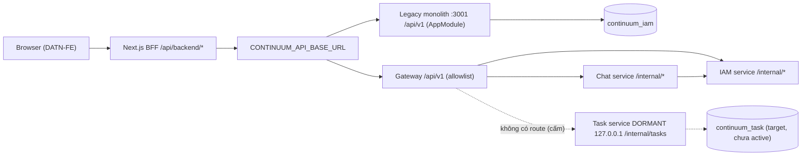
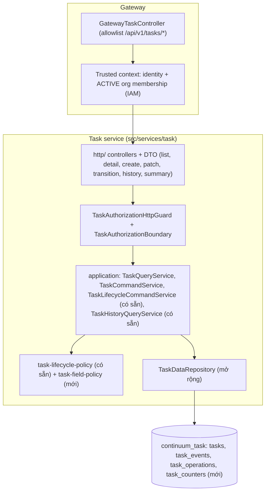

# 05 — Backend Architecture (hiện trạng và đề xuất cho Workspace Task)

## 1. Kiến trúc hiện tại (đã kiểm chứng)

Kết luận: BE là **modular monolith NestJS 11** (DEC-013). Song song có một chế độ microservices qua Gateway, và Task là service **dormant**.

| Thành phần | Vai trò | Evidence |
|---|---|---|
| `src/main.ts` + `src/app.module.ts` | Monolith mặc định (`npm start`), import IAM, Capture, Jira, Lifecycle, Chat, Handover, Ingestion, Notification, AiEngine. **Không** import Task | `src/app.module.ts:14-29` |
| `src/bootstrap.ts` | prefix `api/v1`, helmet, CORS (cho phép `If-Match`, `Idempotency-Key`; expose `ETag`), `ValidationPipe` (whitelist + forbidNonWhitelisted), `StructuredExceptionFilter` | `src/bootstrap.ts:~16-44` |
| `src/gateway/**` | Proxy theo allowlist; rewrite `/api/v1/` → `/internal/`; map timeout → 504, unavailable → 503 | `gateway-iam.controller.ts:914-976`; `gateway.module.ts:18-22` |
| `src/services/<domain>/` | Tầng `controllers/` → `application/` → `infrastructure/mongodb` | cây thư mục `src/services/*` |
| Task service | `main.ts` (loopback), `runtime/**` (policy, lifecycle, history), `http/**` (controller dormant), `infrastructure/mongodb/**` (`TaskDataRepository`) | `src/services/task/**` |
| Authorization | `ProjectAccessAuthorizationGuard` + `AuthorizationPolicy.evaluateProjectAccess` đọc evidence từ Mongo | `project-access-authorization.guard.ts:35-101`; `authorization.policy.ts:304-389` |
| Persistence | Mongoose 8 / MongoDB 7. Database-per-service (ADR-003/DEC-011), `continuum_audit` dùng chung cho audit | `AGENTS.md:19`; `src/common/mongodb/database-names.ts` |
| Cache | Redis chỉ cho Chat, key theo org/actor/generation | `chat-cache.repository.ts:67-134` |
| Queue | Đã khai báo BullMQ names nhưng worker chưa có handler | `*/infrastructure/queues/queue.names.ts`; `src/workers/main.ts` |

**Kiểu kiến trúc:** modular monolith với tầng controller/application/infrastructure tách rõ ràng. Các phần sau được dùng **có chọn lọc**, không áp dụng toàn bộ:
- Repository pattern
- CQRS-lite (Task tách command `TaskLifecycleCommandService` và query `TaskHistoryQueryService`)
- Outbox (email IAM)

Không có event bus chạy thật giữa các module.

## 2. Đề xuất kiến trúc cho Workspace Task (khi gate mở)

**Quyết định:** đặt toàn bộ logic Task trong **Task service sẵn có** (`src/services/task/**`). Không tạo module "work" mới, không thêm collection song song trong IAM.

Lý do:
- ADR-010 đã chốt ranh giới Task.
- ADR-009 chốt Task là nguồn duy nhất.
- Đã có schema, index, repository, policy và history được approve ở mức dormant.
- Tạo module khác sẽ nhân bản source of truth, vi phạm nguyên tắc "không tạo database task thứ hai".

### 2.1 Trách nhiệm từng tầng

| Tầng | Làm | Không làm |
|---|---|---|
| Gateway controller | allowlist path; kiểm tra session; forward trusted context theo DR-3; map 503/504 | business rule, query DB Task |
| Task `http/` | validate DTO (class-validator, whitelist), parse `If-Match`/`Idempotency-Key`, map kết quả sang HTTP | logic nghiệp vụ |
| `TaskAuthorizationBoundary` | lấy evidence ACTIVE org + project membership + role (DR-8); quyết định ALLOW/DENY theo op | tin bất kỳ id hay role nào từ FE |
| Application services | orchestration, CAS, idempotency, transaction (task + event) | chi tiết Mongo |
| Policy | hàm thuần: transition (sẵn có), field-update (mới: ai sửa field nào, `parentId` 1 cấp) | I/O |
| `TaskDataRepository` | query có scope `projectId`, projection, keyset, aggregation, index-aware | quyết định quyền |

**Không thêm** port/adapter interface cho repository vì chỉ có một implementation (Ponytail: "no interfaces with only one implementation"). Repository hiện tại đã là class cụ thể và test được qua disposable DB.

### 2.2 Thay đổi schema đề xuất (gate G6, cần migration MỚI)

`tasks` đang dùng `additionalProperties:false` (`task-database-schema.ts:127-141`). Đề xuất bổ sung các field sau:

| Field | Kiểu | Bắt buộc | Ghi chú |
|---|---|---|---|
| `organizationId` | ObjectId | ✓ (task mới) | **Bất biến**, lấy từ trusted context lúc tạo, không bao giờ nhận từ body. Phục vụ màn hình Manager toàn org và cách ly tenant ở tầng dữ liệu (G10, [07 §12](07-performance-analysis.md)). Cần xác nhận `organizationId` của project bất biến |
| `key` | string | ✓ (task mới) | unique `{projectId, key}` |
| `type` | enum TASK/BUG/STORY | ✓, default TASK | |
| `priority` | enum LOW/MEDIUM/HIGH | ✓, default MEDIUM | |
| `description` | string ≤ 20000 \| null | | |
| `dueDate`, `startDate` | Date \| null | | validate `startDate ≤ dueDate` |
| `parentId` | ObjectId \| null | | chỉ 1 cấp, cùng project |
| `labels` | string[] ≤ 20 | default [] | |

Thêm collection `task_counters {_id: projectId, seq}` để cấp key.

**Migration:**
- Tạo script mới `scripts/migrations/<date>-task-workspace-fields.mjs` (cấm sửa migration cũ). Theo pattern của `20261019-task-lifecycle-contract.mjs`: dry-run report + `--expected-report-sha256` + `--task-writes-paused`.
- Backfill 7-field task cũ:
  - `type=TASK`, `priority=MEDIUM`
  - `organizationId`: Task chưa được kích hoạt nên hiện **chưa có dữ liệu cần backfill**. Nếu đã có task thì phải tra project→org từ IAM trong script migration (đọc chéo database, cần runtime owner phê duyệt)
  - `labels=[]`, các field nullable = `null`
  - `key` cấp theo thứ tự `_id`
- **Rollback:** validator cũ không chấp nhận field mới. Phương án rollback là khôi phục validator mới, hoặc `$unset` các field mới sau khi pause writes. Phải ghi trong decision record.

**Event:** thêm biến thể `TASK_UPDATED {changedFields, version}` vào `task_events`, ghi chung transaction với update. Nhờ vậy history (W14) phản ánh cả thay đổi field.

### 2.3 Concurrency và consistency

| Vấn đề | Cách xử lý | Lý do |
|---|---|---|
| Hai người sửa cùng task | `updateOne({_id, projectId, version: expected}, {$set…, $inc:{version:1}})`; `matchedCount=0` thì đọc lại để phân biệt 404 và 409 | atomic trên 1 document, không cần lock |
| Ghi task + event | transaction (đã có trong `create`/`transitionStatus`) | cần nhất quán đa document; CI dùng replica set |
| Retry create | `Idempotency-Key` lưu trong `task_operations` (TTL 24h, unique `{actorId, projectId, operationId}`) | tái dùng collection có sẵn, không thêm Redis |
| Cấp key song song | `findOneAndUpdate($inc)` + unique index | atomic, không race |
| Distributed lock | **Không dùng** | không có yêu cầu |

### 2.4 Bảo mật

- Object-level authorization ở **mọi** op: query luôn có `projectId` lấy từ path **và** đã được xác thực membership. Lấy task theo `{_id, projectId}` (chống IDOR chéo project).
- `assigneeId` mới phải là ACTIVE project member. Nguồn evidence lấy theo DR-8.
- `assigneeId=me` được resolve ở server.
- **Manager (ADMIN):** hai route `/api/v1/tasks/organization/*` chỉ ADMIN truy cập; role khác nhận 404. Org lấy từ session, và mọi truy vấn của Manager đều ràng buộc `organizationId` từ trusted context. Với route theo project, ADMIN được truy cập mọi project trong org (kể cả PRIVATE), dùng cùng quy tắc phạm vi org của `evaluateProjectReadScope` (`authorization.policy.ts:245-301`).
- Mọi thay đổi do ADMIN thực hiện ghi `actor`/`actorType` vào `task_events` để truy vết (ngoại lệ có chủ đích so với nguyên tắc BA "Manager không mặc nhiên quản lý nội dung project", xem [03 §2.5](03-api-contract-design.md)).
- Không có trường nào nhận `organizationId` hay `role` từ client.
- `q` phải được escape regex và giới hạn độ dài 2–100 để chống ReDoS và full scan. Repo **chưa có** helper escape dùng chung: hàm escape đang bị lặp private ở `platform-administration.repository.ts:243-244`, `project-access.repository.ts:101-102,336`.
  - Khi implement, nên chuyển một bản duy nhất vào `src/common/search/` (cạnh `literal-search.ts`), thay vì viết bản thứ tư.
  - `literalPrefixRange` (`src/common/search/indexed-search.ts`) dùng được nếu chọn tìm theo prefix của `key`.
- CSRF double-submit cho mutation.

**Phát hiện ngoài phạm vi (cần task riêng):** các mutation Project trong `project-access.controller.ts:159-372` **không** kiểm tra CSRF, khác với các controller command của IAM. Cookie `SameSite=Lax` giảm rủi ro nhưng không thay thế được defense-in-depth. Mức độ **Medium**. Ghi nhận ở [09](09-final-audit.md).

## 3. Quyết định chính và tradeoff

| Quyết định | Phương án khác | Lý do chọn |
|---|---|---|
| Native Task là source of truth | Jira-backed; đồng bộ Jira | ADR-009/010 đã chốt; Jira module chỉ có scaffold, không có OAuth/webhook/sync |
| Một list endpoint có filter thay vì board/calendar/timeline endpoint riêng | endpoint theo view | 1 chỗ authz/query; index phục vụ chung; ít API |
| Status chỉ qua `transitions` | `PATCH status` | giữ policy D-08 là nguồn duy nhất |
| Subtask = Task có `parentId` (1 cấp) | collection riêng; materialized path | FE chỉ có 1 cấp; tái dùng toàn bộ lifecycle |
| `subtaskCounts` tính batched lúc đọc | counter denormalized | không lệch dữ liệu; đo cho thấy rẻ (07 §5) |
| Summary on-demand bằng aggregation có index | cache Redis; materialized view | đo ở 07 §6; tránh độ phức tạp invalidation khi chưa cần |
| Không rank/LexoRank | fractional index | FE không có reorder trong cột |
| Keyset pagination | offset | đo ở 07 §2; tương thích DR-6 |
| Error shape hiện tại | RFC 9457 | tránh hai chuẩn lỗi |
| Không thêm queue | BullMQ cho create/update | CRUD đồng bộ, không gọi integration ngoài |
