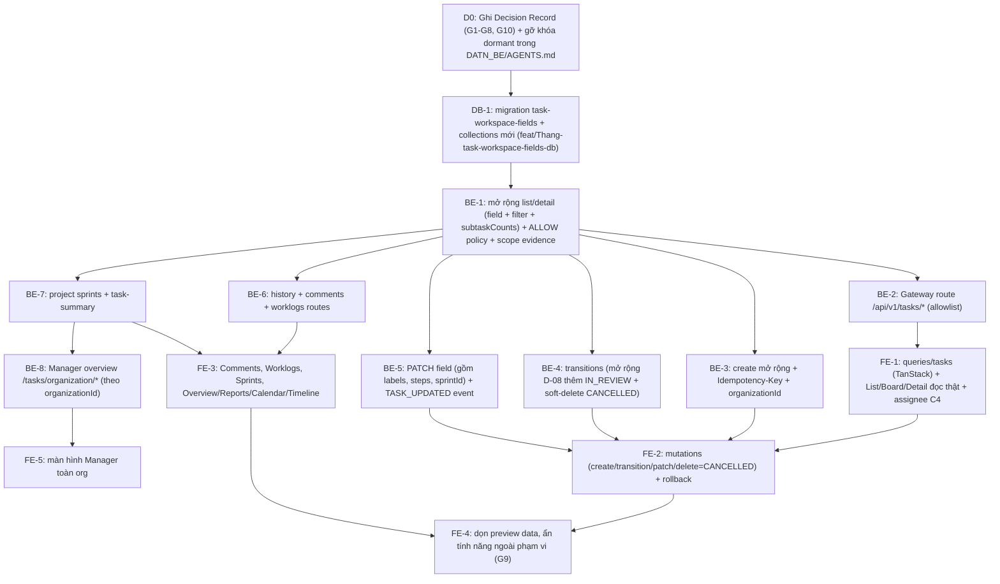

# 06 — Implementation Plan

## 1. Kết quả của đợt này

| Hạng mục | Kết quả | Lý do |
|---|---|---|
| Audit, inventory, gap matrix, contract, kiến trúc, performance (Phase 1–7) | **Hoàn thành**: tài liệu 01–09, OpenAPI 3.1.0 hợp lệ (17 operations), benchmark có số đo thật | – |
| Chốt quyết định nghiệp vụ & kiến trúc (G1, G4, G6, G7, G8, G10) | **Hoàn thành**: Thắng (Product Owner & Runtime Owner) đã xác nhận toàn bộ ngày 2026-10-22 | Đã cập nhật vào [02](02-fe-be-api-matrix.md), [03](03-api-contract-design.md), [04](04-api-inventory.yaml), [05](05-backend-architecture.md), [09](09-final-audit.md) |
| Implement BE Task API (Phase 8) | **Sẵn sàng triển khai ngay sau bước D0 (gỡ khóa dormant trong `AGENTS.md`)** | `DATN_BE/AGENTS.md:7-12,22` hiện vẫn đặt khóa dormant cho `src/services/task/**`; cần commit decision record + cập nhật `AGENTS.md` ở bước `D0` trước khi chạm code runtime |
| Code mới trong repo | **3 file benchmark/test hiệu năng** `scripts/perf/workspace-*.mjs` | chỉ đọc/ghi DB scratch trên loopback, không chạm runtime |

## 2. Lộ trình triển khai (sau khi Thắng đã chốt G1, G4, G6, G7, G8, G10)

Thứ tự được xếp theo dependency thực tế. Mỗi bước là **một branch và PR riêng**, theo `AGENTS.md` workspace (BE/FE/DB tách riêng).

| Bước | Branch đề xuất | Nội dung | Test bắt buộc | Ước lượng |
|---|---|---|---|---|
| D0 | `Document` + `DATN_BE` | Ghi decision record cho G1–G8, G10 (Thắng = runtime owner, trust profile DR-3, scope evidence DR-8, enum `IN_REVIEW`, soft-cancel `CANCELLED`, phạm vi G8, `organizationId` Phương án A) và cập nhật `DATN_BE/AGENTS.md` để mở khóa Task service | – | 0.5 ngày |
| DB-1 | `feat/Thang-task-workspace-fields-db` | Migration mới: `collMod` mở rộng validator `tasks` (thêm `organizationId`, `key`, `type`, `priority`, `description`, `dueDate`, `startDate`, `parentId`, `sprintId`, `labels`, `steps`, status `IN_REVIEW`), `collMod` mở rộng validator `task_events` & `task_operations` (thêm `IN_REVIEW` vào bảng transition `$expr`, thêm các nhánh `TASK_UPDATED`, `TASK_COMMENT_ADDED`, `TASK_WORKLOG_ADDED` vào `oneOf`/`$or`, cập nhật partial unique index `{taskId: 1, version: 1}` cho cả `TASK_STATUS_TRANSITIONED` và `TASK_UPDATED`), tạo `task_counters`, `task_comments`, `task_worklogs`, `project_sprints`, `project_sprint_events` + bộ index (07 §9, §12) | plan test, validator accept/reject spec, `*.mongodb.spec.ts` trên replica set | 1.5–2 ngày |
| BE-1 | `feat/Thang-task-workspace-read-be-api` | DTO query allowlist (gồm `sprintId`), cursor opaque, projection, batched `subtaskCounts`, scope evidence provider thật, policy ALLOW cho ADMIN/TEAM_LEADER/MEMBER | unit + integration + negative (cross-project/org) | 2–3 ngày |
| BE-2 | `feat/Thang-task-gateway-route-be-api` | `GatewayTaskController`, compose/helm entry, `SERVICE_DATABASES` | e2e qua Gateway | 1 ngày |
| BE-3 | `feat/Thang-task-create-ext-be-api` | create mở rộng (cho cả ADMIN không là member project), cấp key atomic, gán `organizationId` từ context, idempotency | concurrency test key unique | 1–1.5 ngày |
| BE-4 | `feat/Thang-task-transition-be-api` | Cập nhật `task-lifecycle-policy.ts` thêm `IN_REVIEW` (tùy chọn trước `DONE`) + HTTP adapter `POST …/transitions` (dùng luôn cho Delete → `CANCELLED`) | unit test bảng transition mới + HTTP e2e | 1–1.5 ngày |
| BE-5 | `feat/Thang-task-update-be-api` | PATCH (`title`, `description`, `priority`, `type`, `assigneeId`, `dueDate`, `startDate`, `parentId`, `sprintId`, `labels`, `steps`) + `task-field-policy` + event `TASK_UPDATED` | CAS 2 writer + quyền Member chỉ sửa task mình tạo/được giao | 1.5 ngày |
| BE-6 | `feat/Thang-task-collab-history-be-api` | Mở rộng `TaskHistoryQueryService` đọc đủ 5 loại `eventType` (`TASK_CREATED`, `TASK_STATUS_TRANSITIONED`, `TASK_UPDATED`, `TASK_COMMENT_ADDED`, `TASK_WORKLOG_ADDED`) + route `history` (D-09) + `GET/POST …/comments` + `GET/POST …/worklogs` | pagination + idempotency + cross-project 404 | 1.5–2 ngày |
| BE-7 | `feat/Thang-task-sprints-summary-be-api` | CRUD + `complete` cho `project_sprints` (chỉ Leader/ADMIN, CAS `If-Match`, ghi `project_sprint_events` + ghi `TASK_UPDATED` cho từng task chưa xong bị dời sprint) + `GET …/task-summary` | partial unique 1 ACTIVE sprint/project + transaction complete sprint kiểm tra history từng task bị dời | 1.5–2 ngày |
| BE-8 | `feat/Thang-task-manager-overview-be-api` | 2 route `/api/v1/tasks/organization/*` chỉ ADMIN, truy vấn theo `organizationId` (G10 Phương án A) | negative: Leader/Member nhận 404; org khác không thấy dữ liệu; project PRIVATE hiển thị cho ADMIN | 1.5 ngày |
| FE-1 | `feat/Thang-workspace-tasks-read-fe-ui` | `src/lib/queries/tasks/**`, thay `INITIAL_PREVIEW_WORK_ITEMS`; kết nối C4 assignee thật; loading/error/empty/403 | vitest + Visual QA Rule 06 | 2 ngày |
| FE-2 | `feat/Thang-workspace-tasks-mutations-fe-ui` | create/transition/patch, Delete = prompt reason → `CANCELLED`, ETag/If-Match, Idempotency-Key, rollback | vitest + Visual QA Rule 06 | 2 ngày |
| FE-3 | `feat/Thang-workspace-collab-sprints-views-fe-ui` | Tích hợp Comments, Worklogs, Checklists, Sprints (Board/Reports), Calendar/Timeline/Overview | vitest + Visual QA Rule 06 | 2–3 ngày |
| FE-4 | `feat/Thang-workspace-preview-cleanup-fe-ui` | Xóa mock dư thừa; ẩn hoặc gắn nhãn rõ cho các tab ngoài phạm vi Task (Docs, Forms, Development, AI) | vitest | 0.5–1 ngày |
| FE-5 | `feat/Thang-manager-task-overview-fe-ui` | Màn hình Manager mới: bảng task toàn org, thẻ tổng hợp theo project, drill-down vào project. Áp dụng Rule 06 đầy đủ (4 viewport, 8 trạng thái) | vitest + Visual QA Rule 06 | 2–3 ngày |

## 3. Quy tắc tích hợp FE (khi triển khai FE-1..FE-5)

| Chủ đề | Quy tắc |
|---|---|
| Query key | `['tasks', organizationId, projectId, 'list', normalizedFilters]`, `['tasks', organizationId, projectId, 'detail', taskId]`, `['tasks', organizationId, projectId, 'summary']`, `['tasks', organizationId, projectId, 'sprints']`. Có `organizationId` để không lộ cache khi đổi org |
| Pagination | `useInfiniteQuery` với `nextAfterId`/`nextCursor` |
| Search | debounce 300 ms; dựa vào `AbortSignal` mà TanStack truyền vào `queryFn` để hủy request cũ |
| Mutation | transition: optimistic update cột Board (`TODO`, `IN_PROGRESS`, `IN_REVIEW`, `BLOCKED`, `DONE`), **rollback** khi 409/422; hiển thị `TASK_TRANSITION_NOT_ALLOWED` và `TASK_TRANSITION_REASON_REQUIRED` rõ ràng. Delete: mở modal nhập `reason` (≥ 5 ký tự) rồi gọi `transitions` sang `CANCELLED`. Create: **không** optimistic, chờ 201 vì key do server cấp |
| Invalidation | sau mutation: `detail(taskId)`, list của project, `summary`, `sprints` (nếu đổi status hoặc `sprintId`) |
| ETag | lưu `ETag` từ detail; gửi `If-Match`; khi 409 thì refetch và báo người dùng |
| Idempotency | key UUID tạo một lần cho mỗi lần submit; retry dùng lại key (giống `OrganizationMembershipManager.tsx:262-267`) |
| Ngoài phạm vi Task (G9) | Work Notes, Docs, Forms, Development, AI: **không** giả lập thành công. Hiển thị trạng thái "Not available yet" cho tới khi G9 được triển khai |

## 4. Việc độc lập làm được ngay (không phụ thuộc Task gate)

| Việc | Repo | Ghi chú |
|---|---|---|
| Sửa các defect FE thuần UI ở 01 §7 (inline create bỏ due/assignee, menu "+ Add" nối sai, nhãn metric sai, confirm khi delete, "Assign to me" dùng user hiện tại) | FE | Không cần BE; có thể làm trên branch FE riêng |
| CSRF cho mutation Project (`project-access.controller.ts:159-372`) | BE | Phát hiện security ngoài phạm vi; cần task riêng |
| Gom helper escape regex vào `src/common/search` | BE | Refactor nhỏ, tách PR |
| Đẩy doc 27 từ branch lên `main` của Document repo | Document | Đang chỉ có trên branch `origin/docs/Phuc-DATN-97-d05-decision-record` |
