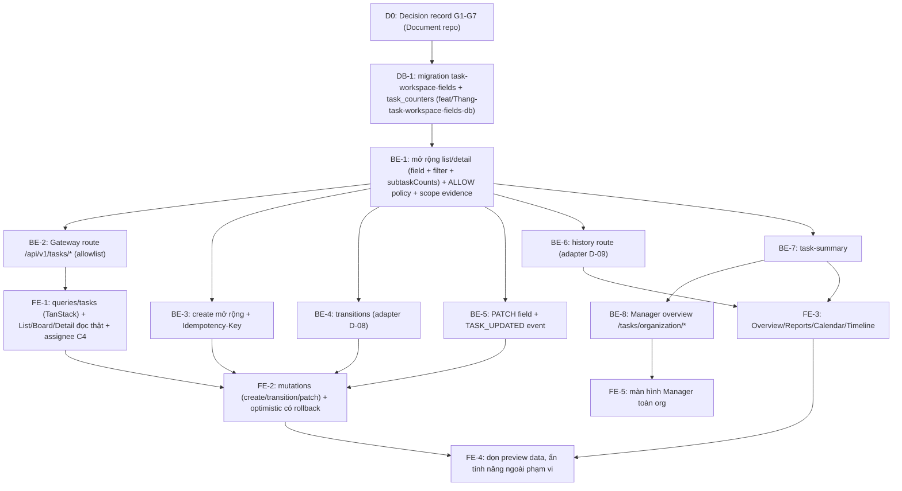

# 06 — Implementation Plan

## 1. Kết quả của đợt này

| Hạng mục | Kết quả | Lý do |
|---|---|---|
| Audit, inventory, gap matrix, contract, kiến trúc, performance (Phase 1–7) | **Hoàn thành**: tài liệu 01–09, OpenAPI hợp lệ, benchmark có số đo thật | – |
| Implement BE Task API (Phase 8) | **Không thực hiện, BLOCKED** | `DATN_BE/AGENTS.md:7-12,22`: Task dormant, cấm Gateway/FE route và mutation/filter/history route; OpenAPI phải được approve trước. DR-3, DR-7(c)(d), DR-8 đang DEFER. Runtime owner của ADR-003 chưa có |
| Tích hợp FE với API thật (Phase 8.3) | **Không thực hiện, BLOCKED** | Không có API work item reachable. Nếu chỉ thay danh sách assignee bằng API thật (C4) trong khi item vẫn là mock thì sẽ trộn hai nguồn dữ liệu và gây hiểu nhầm |
| Code mới trong repo | **1 script đo hiệu năng** `scripts/perf/workspace-query-plans.mjs` | chỉ đọc/ghi DB scratch trên loopback, không chạm runtime |

Không có endpoint, DTO, schema, migration hay FE caller nào được thêm. Đây là kết quả đúng theo governance, không phải bỏ sót.

## 2. Lộ trình sau khi gate mở

Thứ tự được xếp theo dependency thực tế. Mỗi bước là **một branch và PR riêng**, theo `AGENTS.md` workspace (BE/FE/DB tách riêng).

| Bước | Branch đề xuất | Nội dung | Test bắt buộc | Ước lượng |
|---|---|---|---|---|
| D0 | Document repo | Decision record cho G1–G7 (owner, trust profile, scope evidence, permission matrix, enum `IN_REVIEW`, field mở rộng, approve `04-api-inventory.yaml`) | – | Leader/Product |
| DB-1 | `feat/Thang-task-workspace-fields-db` | Migration mới + validator + 4 index (07 §7) + `task_counters`; dry-run report SHA | plan test, `*.mongodb.spec.ts` trên replica set | 1–1.5 ngày |
| BE-1 | `feat/Thang-task-workspace-read-be-api` | DTO query allowlist, cursor opaque, projection, batched `subtaskCounts`, scope evidence provider thật, policy ALLOW cho list/detail | unit + integration + negative (cross-project/org) | 2–3 ngày |
| BE-2 | `feat/Thang-task-gateway-route-be-api` | `GatewayTaskController`, compose/helm entry, `SERVICE_DATABASES` | e2e qua Gateway | 1 ngày |
| BE-3 | `feat/Thang-task-create-ext-be-api` | create mở rộng, cấp key, idempotency | concurrency test key unique | 1–1.5 ngày |
| BE-4 | `feat/Thang-task-transition-be-api` | HTTP adapter cho `TaskLifecycleCommandService` | tái dùng test policy D-08 + HTTP | 1 ngày |
| BE-5 | `feat/Thang-task-update-be-api` | PATCH + `task-field-policy` + event `TASK_UPDATED` | CAS 2 writer | 1.5 ngày |
| BE-6 | `feat/Thang-task-history-route-be-api` | route history | | 0.5 ngày |
| BE-7 | `feat/Thang-task-summary-be-api` | `$facet`/`$group` aggregation | đối chiếu count | 1 ngày |
| BE-8 | `feat/Thang-task-manager-overview-be-api` | 2 route `/api/v1/tasks/organization/*` chỉ ADMIN, ràng buộc `organizationId`; 4 index tiền tố `organizationId` (phụ thuộc G10) | negative: Leader/Member nhận 404; org khác không thấy dữ liệu; project PRIVATE hiển thị cho ADMIN | 1.5–2 ngày |
| FE-5 | `feat/Thang-manager-task-overview-fe-ui` | Màn hình Manager mới: bảng task toàn org, thẻ tổng hợp theo project, drill-down vào project. Cần Rule 06 đầy đủ (4 viewport, 8 trạng thái) | vitest + Visual QA | 2–3 ngày |
| FE-1 | `feat/Thang-workspace-tasks-read-fe-ui` | `src/lib/queries/tasks/**`, thay `INITIAL_PREVIEW_WORK_ITEMS`; loading/error/empty/403 | vitest + Visual QA Rule 06 | 2 ngày |
| FE-2 | `feat/Thang-workspace-tasks-mutations-fe-ui` | create/transition/patch, ETag/If-Match, Idempotency-Key, rollback | vitest | 2 ngày |
| FE-3 | `feat/Thang-workspace-views-fe-ui` | Overview/Reports từ summary; Calendar/Timeline từ range query | vitest + Visual QA | 1.5–2 ngày |
| FE-4 | `feat/Thang-workspace-preview-cleanup-fe-ui` | xóa mock dư thừa; disable nút ngoài phạm vi với nhãn rõ ràng | vitest | 0.5–1 ngày |

## 3. Quy tắc tích hợp FE (khi được phép)

| Chủ đề | Quy tắc |
|---|---|
| Query key | `['tasks', organizationId, projectId, 'list', normalizedFilters]`, `['tasks', organizationId, projectId, 'detail', taskId]`, `['tasks', organizationId, projectId, 'summary']`. Có `organizationId` để không lộ cache khi đổi org |
| Pagination | `useInfiniteQuery` với `nextAfterId`/`nextCursor` |
| Search | debounce 300 ms; dựa vào `AbortSignal` mà TanStack truyền vào `queryFn` để hủy request cũ |
| Mutation | transition: optimistic update cột Board, **rollback** khi 409/422; hiển thị `TASK_TRANSITION_NOT_ALLOWED` và `TASK_TRANSITION_REASON_REQUIRED` rõ ràng. Create: **không** optimistic, chờ 201 vì key do server cấp |
| Invalidation | sau mutation: `detail(taskId)`, list của project, `summary` |
| ETag | lưu `ETag` từ detail; gửi `If-Match`; khi 409 thì refetch và báo người dùng |
| Idempotency | key UUID tạo một lần cho mỗi lần submit; retry dùng lại key (giống `OrganizationMembershipManager.tsx:262-267`) |
| Ngoài phạm vi | Comments, worklog, sprint, docs, forms, development, AI: **không** giả lập thành công. Hiển thị trạng thái "Not available yet" và không persist giả |

## 4. Việc độc lập làm được ngay (không cần gate)

| Việc | Repo | Ghi chú |
|---|---|---|
| Sửa các defect FE thuần UI ở 01 §7 (inline create bỏ due/assignee, menu "+ Add" nối sai, nhãn metric sai, confirm khi delete, "Assign to me" dùng user hiện tại) | FE | Không cần BE; nên làm trên branch FE riêng nếu Thang đồng ý |
| CSRF cho mutation Project (`project-access.controller.ts:159-372`) | BE | Phát hiện security ngoài phạm vi; cần task riêng |
| Gom helper escape regex vào `src/common/search` | BE | Refactor nhỏ, tách PR |
| Đẩy doc 27 từ branch lên `main` của Document repo | Document | Đang chỉ có trên branch `origin/docs/Phuc-DATN-97-d05-decision-record` |
