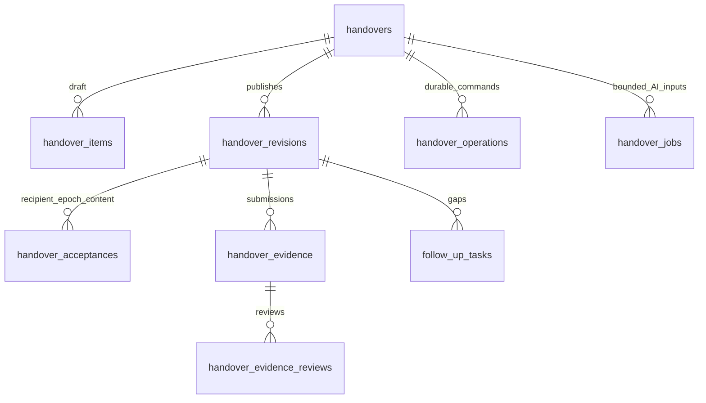

# Handover V2 — additive database contract

Owner: Handover, logical database `continuum_handover`, MongoDB 7.

This is the DB deliverable for knowledge handover. It does not activate a
business API, assign Tasks, run SAG or grant source access. Thang explicitly
confirmed on 2026-10-28 that dependent BE/FE implementation must wait for human
review and merge of the DB PR. No shared database has been migrated.

## Storage changes

The canonical physical specification is
[`handover-v2.contract.cjs`](../../src/services/handover/infrastructure/mongodb/handover-v2.contract.cjs).
Both the migration and Mongoose models consume it; Nest already copies CJS
assets during build. Legacy Mongoose models retain their original fields and
defaults. The three existing collections have separate explicit V2 models
whose model names end in `_v2`; V2 never becomes a default schema version.
New collection model names retain the existing `<database>_<collection>` form.

| Collection                  | Change                                                                                                                                                                                                                          |
| --------------------------- | ------------------------------------------------------------------------------------------------------------------------------------------------------------------------------------------------------------------------------- |
| `handovers`                 | Explicit `schemaVersion:2`, one nullable successor, coordinator, CAS/draft/assignment versions, current revision, terminal actor/time. Partial unique OPEN index for `(organizationId, projectId, departingUserId)` only on V2. |
| `handover_items`            | Explicit V2 draft items, stable item identity, content version/fingerprint, requirements, source versions/citations. No per-item successor requirement in V2.                                                                   |
| `handover_revisions`        | New published snapshots, reviews/gaps, source/task selection, unique revision number per handover; BSON document capped at 4 MiB.                                                                                               |
| `handover_acceptances`      | New package/item acknowledgement history bound to recipient, assignment epoch, revision and item content; unique command identity.                                                                                              |
| `handover_evidence`         | New bounded evidence submissions, result text and up to 10 HTTPS links. No uploads or URL fetching.                                                                                                                             |
| `handover_evidence_reviews` | New review history bound to a submission and its original bindings.                                                                                                                                                             |
| `handover_operations`       | New durable command/transfer intents, bounded safe receipts, fingerprints and lease/fence fields; no TTL, credentials or arbitrary cached bodies.                                                                               |
| `handover_jobs`             | New source-proposal/generation job storage, input draft version and source fingerprint, bounded candidates/results and safe failure codes.                                                                                      |
| `follow_up_tasks`           | Explicit V2 `KNOWLEDGE_GAP`, owner/due/reason and independent resolution version. Legacy milestone rows stay unchanged.                                                                                                         |

MongoDB validators accept absent/1 schema versions **only in the three legacy
collections**. V2 rows have strict field allowlists. Unknown schema versions
are rejected. This expansion neither converts `VERIFIED_BY_SUCCESSOR` nor
legacy `isAcknowledged` into new acceptance/evidence. Original authors and
legacy terminal states remain intact. Responsibilities/interviews/learning
paths, audit/outbox, IAM, Task and SAG databases are unchanged.



References are application references, not MongoDB foreign keys. Read-only
preflight counts dangling local aggregate/revision/submission references and
scope/binding mismatches, invalid rows, legacy/V2 records and duplicate unique
keys. Runtime application commands must still enforce transactions, current
IAM/source ACLs, append-only history, recipient/revision freshness and complete
guards. A collection validator cannot establish human authority, compare a
write with all previous records or prove an external Task assignment. These
checks must not be inferred from a passing schema test.

## Dry-run and apply

The CLI never loads `.env`, never falls back to another service URI and always
selects `continuum_handover`. Use an explicit URI in the invoking process.
Only a single host is supported; ambiguous multi-host targets are refused.
Output contains counts, validators/index definitions and a target/report hash;
it contains no source body, document/User IDs or credentials. Raw driver errors
are suppressed because they can include rejected document content or URI data.

```powershell
$env:HANDOVER_MONGODB_URI = '<reviewed MongoDB URI for continuum_handover>'
node scripts/migrations/20261028-handover-v2.mjs > handover-v2-dry-run.json
$handoverReport = Get-Content -LiteralPath handover-v2-dry-run.json -Raw | ConvertFrom-Json
```

Review the target, inventory, `blockers`, all collection/index actions and the
exact `reportSha256`. Exit code 2 means preflight blockers. Nothing is repaired
automatically. An unfamiliar existing validator or incompatible same-key/name
index blocks apply instead of being overwritten or dropped.

Pause Handover writers, take the owner's normal backup and keep them paused
through apply. Apply re-reads the full preflight and compares the exact reviewed
hash **before any DDL**. Count/index/schema/target drift requires a new review.
`--writes-paused` is an operator assertion, not an automatic distributed lock.

```powershell
node scripts/migrations/20261028-handover-v2.mjs --apply --writes-paused "--expected-report-sha256=$($handoverReport.reportSha256)"
```

A remote/SRV target additionally requires `--allow-shared-database` on both
dry-run and apply and `HANDOVER_MIGRATION_CONFIRM_DATABASE=continuum_handover`
in the invoking process. This guard does not authorize deploying to a shared
environment; use the project's human approval process.

The migration only creates missing collections/indexes or installs its strict
validator on compatible existing collections. It does not rewrite, backfill,
delete or drop data/indexes. Re-running after a clean apply is a no-op. DDL is
not one transaction: an infrastructure failure can leave a partial additive
expansion. Keep writers paused, inspect a fresh dry-run, review its new hash and
resume. Final inspection must show no blockers and all actions `KEEP`.

## Rollback

Disable/quiesce Handover V2 routes/workers and preserve all records, operations,
evidence, snapshots, validators and indexes. Do not let a legacy writer update
V2 records. Existing legacy rows remain readable with legacy models; this is
not permission to use an old binary as a V2 writer. Remove an index/validator
only through a separately reviewed rollback after confirming no V2 dependency.
Do not delete collections or erase historical acknowledgements to roll back.

## Validation

```powershell
npm ci --ignore-scripts
npm test -- --runInBand handover-v2.schemas.spec.ts
npm run test:handover-v2:plan
npm run test:handover-v2:mongodb
npm run test:migrations:plan
npm run check
```

The MongoDB test starts a disposable loopback replica set, pinned to 7.0.24;
it never reads development credentials or uses an existing database URI.
See [the task record](../../tasks/knowledge-handover-db/todo.md) for actual
results and remaining human/runtime gates.
