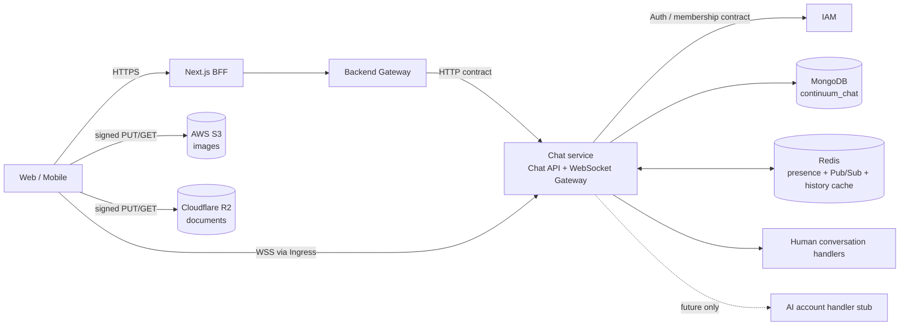

# Kiến trúc Chat người với người

> Trạng thái: Chat v1 đã được triển khai theo contract
> [`chat-v1.openapi.json`](../../../docs/openapi/chat-v1.openapi.json). Đây là
> phạm vi do người dùng yêu cầu và xác nhận; không hàm ý có phê duyệt riêng từ
> Product, Security hoặc Architecture. AI vẫn là stub chưa được nối vào luồng.
> Cập nhật: 2026-10-21.

## 1. Quyết định kiến trúc

| Chủ đề | Quyết định |
| --- | --- |
| Ranh giới nghiệp vụ | Chat 1-1, room và participant AI về sau cùng thuộc `services/chat`. Không tạo Messaging service hoặc database mới. |
| Dữ liệu bền vững | MongoDB `continuum_chat` là nguồn sự thật cho conversation, member và message. |
| Kết nối realtime | WebSocket WSS trong Chat service; HTTP qua BFF/Gateway cho lệnh gửi tin và truy vấn lịch sử. |
| WebSocket adapter | Dùng NestJS `ws` adapter ở giai đoạn triển khai vì giao thức hiện chỉ cần event envelope và subscription do Chat kiểm soát. NestJS mô tả adapter này nhanh hơn Socket.IO nhưng ít tính năng dựng sẵn; phải benchmark với tải thực tế trước production. [NestJS `ws` adapter docs](https://docs.nestjs.com/websockets/adapter) |
| Redis | Giữ session lease, rate limit, ticket, Pub/Sub realtime và cache-aside trang history 10 giây theo organization/conversation/actor/cursor. MongoDB vẫn là nguồn sự thật; cache key theo actor vì reaction có `reactedByMe`. |
| Media | Upload ảnh trực tiếp lên AWS S3, tài liệu trực tiếp lên Cloudflare R2 qua URL ký sẵn; Chat xác minh size/MIME bằng HEAD, giữ metadata trong Mongo và cấp URL tải 5 phút sau khi kiểm tra membership. |
| Presence audience | Gửi trạng thái realtime cho peer direct đang được watch. Search trả snapshot cho candidate được IAM cho phép; không phát trạng thái toàn cục. |
| Trạng thái giao/đọc | Lưu cursor delivered và read trên member của conversation, không tạo receipt cho từng cặp message-recipient. |
| AI | Có điểm mở rộng `handleAiAccountMessage()` nhưng không kết nối hay gọi AI trong phiên bản này. |
| Scale | Bắt đầu bằng Chat service hiện tại chạy nhiều replica nếu cần. Chỉ tách process gateway/relay trong cùng bounded service khi metrics chứng minh socket/fan-out là nút thắt. |

Không chọn PostgreSQL, NATS, Kafka, Cassandra hay ScyllaDB cho v1. Đây không phải kết luận các công nghệ đó kém; hiện dự án đã có MongoDB per-service và Redis, chưa có dữ liệu tải chứng minh cần thêm hệ lưu trữ hay broker khác.

HTTP business operations terminate in Chat. WebSocket connections route directly through the existing ingress to Chat, avoiding a per-frame hop through Next.js. Gateway/BFF provide the project's public API boundary; they do not own chat messages, membership, presence, or fan-out.

## 2. Hiện trạng trong repository

- `ChatModule` và `services/chat/main.ts` chạy riêng trên database `continuum_chat`. Gateway công khai API dưới `/api/v1/chat`; Chat service dùng prefix nội bộ `/internal/chat`.
- Human chat có bộ sưu tập mới `chat_conversations`, `chat_members` và `chat_conversation_messages`. Bộ sưu tập `chat_sessions` / `chat_messages` RAG cũ không bị đổi nghĩa hoặc tái sử dụng.
- `ChatInfrastructureModule` dùng MongoDB và Redis hiện có; Redis bổ sung ticket một lần, rate limit, presence lease và Pub/Sub. Không thêm datastore hay broker.
- `bootstrapService` hiện dùng Nest Redis transport cho internal message pattern. Đây là service transport hiện có, không tự tạo WebSocket gateway hoặc presence routing.
- FE có BFF API client, trang `/chat`, danh sách conversation, search member/message, tạo direct/room, cursor history với inline reply, gửi tin, preview ảnh trước khi gửi, skeleton khi tải ban đầu, cuộn lên để tải history cũ, delivered/read cursor, per-user typing, presence và reconnect với exponential backoff + jitter.
- IAM là nguồn sự thật cho organization membership. Chat gọi IAM để xác thực session và chỉ phân giải member `ACTIVE` của organization hiện tại; Chat không đọc trực tiếp database IAM.

Các endpoint nghiệp vụ có contract trong `docs/openapi/chat-v1.openapi.json`; mọi thay đổi payload, quyền, status code hoặc event envelope phải cập nhật contract cùng implementation.

## 3. Mô hình hội thoại và dữ liệu

### `chat_conversations`

Lưu `type = DIRECT | ROOM`, `organizationId`, trạng thái và summary cuối cùng. Organization lấy từ IAM actor, không nhận từ client. Project/team chat chưa thuộc v1.

Conversation 1-1 có `directKey` duy nhất được tạo từ hai participant đã chuẩn hóa cùng organization. Cùng một cặp trong cùng organization mở lại conversation cũ thay vì tạo bản sao.

### `chat_members`

Một document cho mỗi user trong conversation, gồm conversation, user ID, tên/avatar snapshot, trạng thái membership, role trong room và delivered/read cursor. V1 chỉ cho người thật tham gia. Direct có hai member; room tối đa 50 người gồm owner. Room không nhét danh sách thành viên vào một document.

### `chat_conversation_messages`

Collection human chat là `chat_conversation_messages`, tách khỏi `chat_messages` RAG. Lưu conversation, sender snapshot, nội dung, `clientMessageId`, reply target, reaction, attachment metadata và thời điểm server nhận. Reply là message thường trong cùng timeline; mỗi reply trỏ trực tiếp tới message được trích dẫn. Edit/delete là update/tombstone; object key và provider chỉ lưu nội bộ, không trả về client.

Các index khởi điểm:

- Unique `directKey` cho DIRECT.
- Unique `{ conversationId, userId }` cho membership; index theo `{ userId, organizationId, status, conversationId }` để lấy danh sách chat của một user.
- `{ conversationId, createdAt: -1, _id: -1 }` cho tải history bằng cursor; không dùng `skip/offset` trên lịch sử dài.
- Compound text index `{ conversationId, content: 'text' }` được giữ nguyên. Tìm kiếm hiện dùng chuỗi con literal theo conversation, không phân biệt hoa/thường và dấu tiếng Việt; không dựa vào text index để hỗ trợ khớp một phần từ. Khi lịch sử lớn, cần đo query trước khi bổ sung search index phù hợp.
- Unique `{ conversationId, senderId, clientMessageId }` để một lần gửi có thể retry mà không tạo message trùng.
- `chat_uploads` có unique upload ID và TTL cho metadata upload; message giữ metadata cần thiết để Chat cấp URL tải sau khi membership được kiểm tra.

Cursor dùng cặp `(createdAt, _id)` để thứ tự ổn định khi nhiều message có cùng timestamp. Trang history gồm cả reply, giới hạn theo số lượng nhỏ cố định và tải tiếp bằng cursor. Reply preview được nạp theo batch cho các message trong trang để tránh truy vấn từng reply. Không tải toàn bộ message hoặc member list của room vào một request.

`lastDeliveredMessageId`/`lastDeliveredAt` và `lastReadMessageId`/`lastReadAt` đặt trên `chat_members`. Không ghi trạng thái delivered/read theo từng người nhận của từng message. Reply dùng `replyToMessageId` để trích dẫn trực tiếp bất kỳ message còn tồn tại trong cùng conversation; reply nằm trong timeline chung.

## 4. HTTP commands và WebSocket events

### Đường gửi và đọc dữ liệu

Các command bền vững đi qua FE BFF → Backend Gateway → Chat service. HTTP v1 gồm candidate/conversation, tạo direct/room, cursor history/search, upload nội dung file bằng stream/complete/download URL, gửi/sửa/xóa/reaction message, delivered/read cursor và cấp WebSocket ticket. Ảnh vẫn vào AWS S3, tài liệu vào Cloudflare R2; bytes đi qua hai backend hop để trình duyệt không phụ thuộc CORS bucket. Tải ảnh/tài liệu vẫn dùng URL ký ngắn hạn sau khi Chat xác minh membership. Reply dùng cùng send-message API và xuất hiện trong history cursor như các message khác. Tất cả được scope bằng actor hiện tại từ IAM.

Danh sách direct/room được tải qua HTTP API và đọc từ MongoDB. Trang message cũng đi qua HTTP API, nhưng Chat kiểm tra membership rồi dùng cache-aside Redis cho mỗi trang cursor trong 10 giây; cache miss hoặc Redis lỗi sẽ đọc MongoDB. Redis là cache phía server, không phải endpoint mà trình duyệt gọi trực tiếp.

Chọn HTTP cho command gửi tin vì nó khớp BFF/Gateway hiện có, dùng được auth/error/idempotency contract chuẩn và có ACK rõ ràng sau khi message được ghi. Client có thể optimistic-render ngay khi người dùng bấm gửi; không cần chờ round-trip để bắt đầu render. Đây cũng là mẫu Slack công bố: client duy trì WebSocket nhận event nhưng gửi message qua Webapp API.

ACK xác nhận insert message với MongoDB `w: majority`, timeout 5 giây; Chat không chờ socket người nhận. Client retry bằng cùng `clientMessageId`; unique index trả lại message cũ thay vì ghi trùng. FE giữ cùng ID khi retry cùng nội dung và reuse upload IDs đã xác minh. Gửi message kèm file hoặc reply dùng transaction để tiêu thụ upload records, insert message và cập nhật summary nguyên tử. Tạo room dùng `clientRoomId` với unique key để retry không nhân đôi.

Sau khi lưu, Chat phát event `message.created` vào channel Pub/Sub nội bộ; mỗi replica chỉ gửi event tới session cục bộ của các member. Nếu người nhận offline, message vẫn đọc được qua history khi reconnect. Subscriber mất kết nối có thể bỏ lỡ event, vì vậy client đồng bộ tiếp từ cursor sau reconnect hoặc khi mở lại conversation.

### WebSocket

Một WSS connection nhận message create/update/delete, conversation update, delivered/read cursor, snapshot/cập nhật presence và `typing`. Typing không ghi Mongo; FE theo dõi từng user và tự hết hạn, còn server throttle typing-start nhưng luôn relay typing-stop. Subscribe conversation xác minh membership trước khi ghi socket vào map cục bộ. Message/conversation event chỉ gửi đến socket thuộc các member trong event; typing chỉ gửi đến socket đang subscribe conversation.

History dùng cursor `(createdAt, _id)` trên MongoDB. Chat cache response page trong Redis 10 giây theo actor, conversation, page size, cursor và generation; mutation message tăng generation để page cũ không được dùng lại. Redis lỗi thì bỏ cache và đọc Mongo. History luôn xác minh membership trước cache lookup; cache không thay thế quyền truy cập hay persistence.

Ingress chuyển `/internal/chat/ws` trực tiếp tới WebSocket Gateway trong Chat, không qua Next.js BFF từng frame. Ticket một lần tối đa 30 giây đi trong WebSocket subprotocol, không nằm trong URL. Handshake xác thực lại access token với IAM và đối chiếu token hash/actor với ticket; session được revalidate với IAM mỗi 60 giây và kiểm tra revoke trong Redis mỗi 20 giây. Origin phải khớp `CHAT_ALLOWED_ORIGINS`; frame tối đa 16 KiB, socket gửi chậm hơn 256 KiB bị đóng.

Mỗi Chat node giữ map session/user/conversation/presence watcher trong memory. Redis hiện dùng một Pub/Sub channel `continuum:chat:events:v1` giữa các replica; mỗi node nhận event nội bộ rồi local map chỉ phân phối tới member session hoặc authorized watcher tương ứng. Điều này không phát presence tới mọi user, nhưng mọi replica Chat vẫn xử lý envelope nội bộ. Nếu số replica/event tăng đủ để thấy chi phí này trong metrics, bước nâng cấp là route tới node có user/conversation listener thay vì fan-out channel chung; v1 chưa cần thêm index/lease routing phức tạp.

## 5. Presence theo quan hệ, không theo toàn hệ thống

Presence là trạng thái tạm của các session, không phải dữ liệu nghiệp vụ bền vững. Redis sorted set giữ lease cho từng connection/device, lease 75 giây, ping mỗi 20 giây. Một user online nếu còn ít nhất một lease hợp lệ. Heartbeat không ghi Mongo; event chỉ phát khi trạng thái đổi. Nếu process chết đột ngột, node của người đang watch kiểm tra lại snapshot theo heartbeat để gửi offline khi lease hết hạn.

Khi UI mở danh sách direct conversation hoặc một trang kết quả search:

1. Chat lấy target list từ conversation membership hoặc directory search đã được phép trong tenant/scope.
2. Chat đăng ký watcher cho các target đủ quyền đang hiển thị; không tin danh sách `userIds` tùy ý từ client.
3. Chat đọc snapshot presence song song cho đúng danh sách mục tiêu và trả về trạng thái ban đầu.
4. Khi target online/offline, Chat gửi event tới socket watcher hợp lệ trên mỗi Chat node.
5. Khi rời màn hình, hủy watcher. Khi reconnect, đăng ký lại rồi đọc snapshot mới.

V1 chỉ gửi presence realtime tới peer đang watch và đã có direct conversation; room presence chưa được cung cấp. Search lấy tối đa 20 active member trong organization qua IAM rồi đọc presence cho đúng trang kết quả, không truy vấn hoặc broadcast tất cả người online. Nếu “liên hệ” sau này là friend/accepted relationship độc lập, IAM/domain sở hữu quan hệ cần cung cấp danh sách đó; Chat không tạo persistence presence cho từng cặp.

Một trạng thái chuyển online sẽ có chi phí theo số watcher hợp lệ, không theo tổng số user online. Nếu sản phẩm bắt buộc báo mọi contact dù họ không mở chat, chi phí vẫn tỷ lệ với số contact cần báo; không có cách gửi tức thời tới K người với chi phí nhỏ hơn K. Bản v1 chọn active watchers để giảm fan-out và chỉ hiển thị status snapshot cho người đang tìm kiếm.

Không lưu `lastSeenAt` hoặc presence document trong MongoDB. Khi Redis không sẵn sàng, trạng thái presence giữ last-known cho đến khi đọc lại được; sau reconnect UI lấy snapshot mới.

## 6. Phân quyền và chống rò dữ liệu

- Chat scope mọi conversation theo organization; DIRECT yêu cầu hai account hợp lệ trong scope. ROOM yêu cầu membership còn hiệu lực.
- IAM là nguồn sự thật cho trạng thái user và organization membership. Mỗi HTTP request và WebSocket handshake kiểm tra active session/membership qua IAM; socket đang mở được revalidate định kỳ. Chat tuyệt đối không đọc thẳng Mongo IAM.
- Chat kiểm tra actor/organization qua IAM trên từng HTTP request và kiểm tra membership conversation trên mỗi history/send/read/subscribe/typing. Không dùng ID từ client làm bằng chứng quyền. IAM có endpoint hẹp chỉ trả candidate active trong organization hiện tại; endpoint này không mở rộng `UserDirectoryService.list()` cho admin directory.
- Presence visibility là policy riêng với quyền gửi message. Có thể cho phép xem presence nhưng không nhắn, hoặc ngược lại, theo policy đã chọn.
- WebSocket yêu cầu WSS, allowlist `Origin`, giới hạn kích thước message, rate limit, session expiry/revocation và giới hạn queue gửi mỗi socket. Socket chậm bị ngắt/bỏ event tạm để tránh tăng memory không giới hạn; message bền vững được tải lại bằng history cursor. Đây là các kiểm soát cần có vì WebSocket không tự cung cấp authentication/authorization; xem [OWASP WebSocket Security](https://cheatsheetseries.owasp.org/cheatsheets/WebSocket_Security_Cheat_Sheet.html).
- `signGatewaySource()` hiện chứng minh nguồn IP cho luồng login IAM; không dùng nó làm bằng chứng actor/user cho Chat.

## 7. Bài học từ các hệ thống lớn và cách áp dụng

1. **Slack — route theo channel và kết nối bền vững.** Slack mô tả WebSocket Gateway nhận event, Channel Server sở hữu tập channel theo consistent hash, rồi chỉ gửi tới gateway đang subscribe channel đó. Message command đi qua API. Bài học cho Continuum: một conversation là routing key; gateway chỉ nhận channel nó đang phục vụ. Chưa cần consistent hash ở v1 vì room/traffic chưa có số liệu chứng minh hotspot. [Slack Real-time Messaging](https://slack.engineering/real-time-messaging/)
2. **Discord — lazy subscription giảm fan-out.** Với server lớn, Discord tách “passive” khỏi active sessions: client chưa mở server không nhận toàn bộ event. Họ báo khoảng 90% connection ở server rất lớn là passive, giúp giảm đáng kể công việc fan-out. Áp dụng vào đây: chỉ theo dõi presence/room roster đang hiển thị; không phát online event toàn org. Room message vẫn tới các member online theo membership và policy. [Discord Maxjourney](https://discord.com/blog/maxjourney-pushing-discords-limits-with-a-million-plus-online-users-in-a-single-server)
3. **Discord — fan-out là giới hạn thực, không chỉ là database.** Một room có tốc độ message R và K người nhận cần xấp xỉ R×K lần giao event. Vì thế phải đo room nóng, bớt event tạm không cần, đẩy fan-out ra khỏi request đang xử lý khi cần và chỉ thêm relay/sharding khi số đo chứng minh nghẽn. [Discord Maxjourney](https://discord.com/blog/maxjourney-pushing-discords-limits-with-a-million-plus-online-users-in-a-single-server)
4. **Discord — không sao chép stack vì tên tuổi.** Discord từng dùng MongoDB rồi Cassandra và đến 2023 mô tả vấn đề vận hành/latency ở cụm Cassandra rất lớn trước khi đổi hướng. Bài học: Continuum nên giữ MongoDB service-owned, schema/index theo query pattern và chỉ đổi datastore khi có benchmark/load/ops evidence. [How Discord Stores Trillions of Messages](https://discord.com/blog/how-discord-stores-trillions-of-messages)
5. **Đo profile trước khi tối ưu.** Discord gần đây mô tả việc đo thời gian theo loại event và phát hiện instrumentation/tracing tự nó có overhead ở hot path. Chat cần đo p50/p95/p99 end-to-end, event-loop lag, Mongo query latency, Redis publish, queue depth, bytes/socket và fan-out count; sampling trace có kiểm soát thay vì log/tracing mọi frame. [Tracing Discord’s Elixir Systems](https://discord.com/blog/tracing-discords-elixir-systems-without-melting-everything)
6. **Retry không được biến lỗi thành bão tải.** Một outage của Discord ghi nhận retry khi service timeout đã làm cluster quá tải nặng hơn. Message command dùng idempotency; client/server retry có giới hạn, exponential backoff + jitter; khi overload ưu tiên message bền vững và tắt typing/presence phụ trước. [Discord Authentication Outage](https://discord.com/blog/authentication-outage)

Đây là các pattern và bài học vận hành, không phải lý do chuyển Continuum sang Erlang, Rust, Scylla hay một topology toàn cầu.

## 8. Failure behavior và độ bền

| Sự cố | Hành vi |
| --- | --- |
| MongoDB không ghi được | Không ACK message; client retry cùng `clientMessageId`. |
| Redis Pub/Sub tạm lỗi sau khi lưu | Message vẫn đã lưu; event có thể mất nên client đồng bộ history khi resume. Presence/typing không đáng tin trong thời gian Redis lỗi. |
| User mất mạng/gateway chết | Lease hết hạn; watcher kiểm tra snapshot, client reconnect và tải message sau cursor. |
| WSS client nhận trùng | Dedupe theo `messageId`; event không thay đổi nguồn sự thật trong Mongo. |
| Gateway/Chat quá tải | Giới hạn queue/socket; bỏ typing/presence trước, áp backoff; không giữ unbounded buffer. |

MongoDB transaction dùng khi tạo room và gửi message có file/reply để các bản ghi thay đổi nguyên tử; tin văn bản thường dùng một insert và conditional summary update. Heartbeat và event tạm không dùng transaction. ACK message dùng `w: majority` với write timeout 5 giây. Đo latency quorum trên topology triển khai trước khi đặt SLO. Message insert dùng unique idempotency index; summary cập nhật có điều kiện để list nhanh. Nếu event lỗi sau insert, retry cùng `clientMessageId` không tạo bản ghi thứ hai. Multi-document transaction tốn hơn single-document write, nên không bọc heartbeat, typing hay tin văn bản thường vào transaction. [MongoDB write concern](https://www.mongodb.com/docs/manual/reference/write-concern/), [MongoDB transactions](https://www.mongodb.com/docs/manual/core/transactions/).

Redis Pub/Sub có at-most-once semantics; khi subscriber ngắt kết nối, event trong thời gian đó không được phát lại. Vì vậy chỉ dùng Pub/Sub để báo realtime; không dùng làm kho message. V1 có một channel nội bộ mà mỗi Chat replica nhận, sau đó lọc theo session/user cục bộ. Redis `PUBLISH` có chi phí theo subscriber của channel; chuyển sang định tuyến node cụ thể nếu metrics cho thấy replica fan-out là bottleneck. [Redis Pub/Sub](https://redis.io/docs/latest/develop/pubsub/), [Redis `PUBLISH` complexity](https://redis.io/docs/latest/commands/publish/).

Danh sách thành viên room lưu thành documents riêng, không phải mảng tăng vô hạn trên conversation; MongoDB cảnh báo unbounded arrays có thể làm tăng tài nguyên, giảm hiệu quả index và vượt giới hạn document. [MongoDB Avoid Unbounded Arrays](https://www.mongodb.com/docs/manual/data-modeling/design-antipatterns/unbounded-arrays/).

## 9. Đã triển khai và điểm mở rộng

V1 có HTTP/BFF/Gateway/Chat contract, Mongo repositories/indexes, cursor history với Redis cache-aside, idempotent direct/room/message commands, full-text conversation search, inline quoted replies, reactions/edit/delete, ảnh S3 và tài liệu R2 qua upload stream có kiểm tra kích thước, delivered/read cursors, actor-scoped rate limits, one-use WSS ticket, IAM membership validation, contact-scoped presence, per-user typing, reconnect và chat UI responsive.

Upload không cần bật CORS cho bucket vì trình duyệt gửi stream đến Chat qua BFF/Gateway; Chat xác minh actor, conversation, upload record và số byte trước khi ghi object. Download dùng URL ký ngắn hạn, không bật public read. Credentials/bucket nằm trong deployment secret, không đưa signed URL vào log hoặc Redis history cache.

Trước production, đo p50/p95/p99 từ HTTP send đến ACK, Mongo majority latency, Redis Pub/Sub delivery, active sockets/replica, fan-out per room, event-loop lag, Redis reconnect, stale presence recovery và behavior khi IAM unavailable. Không đặt SLO/concurrency target khi sản phẩm chưa xác định.

### Ngưỡng mở rộng sau v1

- Tách role WebSocket gateway khỏi HTTP worker trong cùng `services/chat` khi connection memory/event-loop lag làm hỏng API latency.
- Thay global Chat Pub/Sub channel bằng node/user-targeted routing khi internal event delivery giữa replica thành bottleneck thực đo được.
- Thêm relay riêng cho room cực lớn khi một node không xử lý fan-out đủ nhanh.
- Thêm search index/outbox durable stream chỉ khi có yêu cầu sản phẩm và số liệu chứng minh query hoặc event loss không còn đáp ứng được.

Không thiết kế sẵn số replica, giới hạn room, SLO hay heartbeat cố định khi chưa có concurrency target và benchmark production-like.
